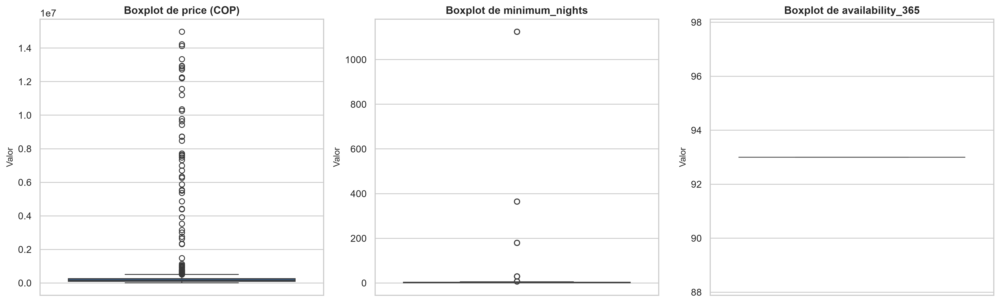
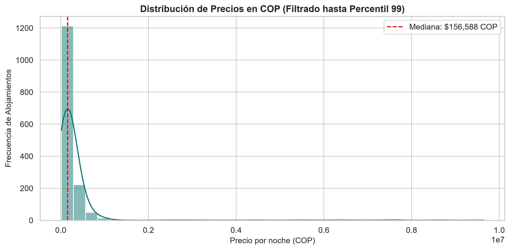

# PROCESO ETL CON LOS DATASETS DE AIRBNB BOGOTÁ, D.C.
## INFORME TÉCNICO Y ANALÍTICO DE INTELIGENCIA DE NEGOCIOS

---

**Integrantes del Proyecto:**
- Juan Carlos Escobar Gil - 1033649534

**Asignatura:** Inteligencia de Negocios
**Docente:** Carlos Andres Jaramillo Patiño
**Institución:** ITM
**Fecha:** Octubre de 2026

---

## 1. Introducción

En el entorno de la economía colaborativa y los servicios digitales de hospedaje, la toma de decisiones estratégicas depende de la disponibilidad de datos íntegros, estructurados y normalizados. Plataformas como Airbnb generan volúmenes continuos de transacciones, opiniones y cambios en disponibilidad tarifaria. No obstante, al ser capturados o extraídos en formatos semiestructurados (como volcados web o bases documentales NoSQL), los datos suelen presentar redundancia, formatos heterogéneos, inconsistencias semánticas y anomalías estadísticas que impiden su explotación directa por modelos de Business Intelligence (BI) y analítica prescriptiva.

En este contexto, el diseño de un proceso de **Extracción, Transformación y Carga (ETL)** robusto constituye la piedra angular para habilitar la toma de decisiones empresariales sobre el mercado inmobiliario turístico de Bogotá, D.C. Bogotá representa una plaza heterogénea caracterizada por diversas dinámicas de demanda entre el turismo corporativo (centros de negocios en Chapinero, Usaquén y Salitre) y el turismo vacacional/cultural (La Candelaria, Teusaquillo).

El presente proyecto implementa un pipeline ETL de extremo a extremo desarrollado bajo el paradigma de **Programación Orientada a Objetos (POO)** en Python. El flujo desacopla rigurosamente las fases del procesamiento, extrayendo datos crudos desde una base de datos local en **MongoDB**, ejecutando limpieza, estandarización de tipos, tratamiento de atípicos y categorizaciones con **Pandas**, para finalmente persistir los resultados tanto en una base relacional analítica (**SQLite**) como en reportes planos de intercambio (**Excel .xlsx**).

---

## 2. Descripción del Dataset

La fuente de datos proviene de los repositorios abiertos de *Inside Airbnb* correspondientes a la plaza de Bogotá, D.C. Los registros se encuentran consolidados en una instancia de **MongoDB** local bajo la base de datos `airbnb_bogota`, distribuidos en tres colecciones interconectadas mediante identificadores relacionales:

````plantuml
@startuml
hide methods
hide stereotypes
skinparam linetype ortho

entity "Listings\nPropiedades / Anuncios" as Listings {
  * id : ObjectId <<PK>>
}

entity "Reviews\nComentarios / Calificaciones" as Reviews {
  * listing_id : ObjectId <<FK>>
}

entity "Calendar\nDisponibilidad / Precios" as Calendar {
  * listing_id : ObjectId <<FK>>
}

Listings ||--o{ Reviews : "contiene"
Listings ||--o{ Calendar : "define"
@enduml
`````

### 2.1. Colección `Listings`
Contiene la radiografía estática y descriptiva de las propiedades ofertadas. Comprende atributos fundamentales como:
- `id`: Identificador numérico del anuncio.
- `name` y `description`: Contenido textual del anuncio.
- `host_id`, `host_name`, `host_is_superhost`: Atributos y reputación del anfitrión.
- `neighbourhood_cleansed`: Localidad o barrio oficial de Bogotá (ej. Chapinero, Usaquén, Santa Fe).
- `room_type`: Tipología (Alojamiento entero, Habitación privada, Habitación compartida).
- `price`: Tarifa por noche publicada.
- `minimum_nights` y `maximum_nights`: Políticas de estancia requeridas.
- `availability_365`: Días del año con disponibilidad de reserva.
- `number_of_reviews`, `review_scores_rating`: Métricas acumuladas de satisfacción.

### 2.2. Colección `Reviews`
Registra el histórico de comentarios y reseñas redactados por los huéspedes para cada propiedad:
- `listing_id`: Clave foránea que referencia al anuncio en `Listings`.
- `id`: Identificador único de la reseña.
- `date`: Fecha en que el usuario registró su valoración.
- `reviewer_id` y `reviewer_name`: Identidad del huésped.
- `comments`: Reseña cualitativa en texto libre.

### 2.3. Colección `Calendar`
Estructura de series de tiempo de alta cardinalidad (proyecciones de 365 días por cada propiedad activa):
- `listing_id`: Clave foránea al alojamiento.
- `date`: Fecha de la noche proyectada.
- `available`: Indicador booleano ('t' / 'f') de disponibilidad.
- `price`: Tarifa dinámica específica para esa fecha calendario.

---

## 3. Resumen del Análisis Exploratorio de Datos (EDA)

Durante la fase de exploración inicial ejecutada en el entorno interactivo de Jupyter Notebook (`notebooks/exploracion_airbnb.ipynb`), se identificaron diversas fallas de calidad de datos que justifican la necesidad del proceso ETL:

### 3.1. Cardinalidad y Volumetría
- **Listings:** Presenta entre 14.000 y 16.000 propiedades registradas. Si bien es una colección de tamaño moderado, su esquema es ancho (más de 70 atributos originales) con fuerte variabilidad documental.
- **Reviews:** Supera las 350.000 reseñas históricas. Su principal desafío reside en la consistencia de tipos en campos de fecha y la presencia de caracteres no imprimibles o saltos de línea irregulares en las cadenas de texto.
- **Calendar:** Al multiplicar las propiedades por el horizonte anual, supera los 5 millones de registros. Esto demostró la inviabilidad de persistir esta colección completa en herramientas como Excel sin particionamiento previo.

### 3.2. Valores Nulos e Inconsistencias Estructurales
Se identificaron tres patrones críticos de valores nulos:
1. **Columnas vacías o con nulos superiores al 90%:** Atributos como `license` (la regulación local no solía exigir número de licencia visible en el scraping original), `calendar_updated` y `neighbourhood_group_cleansed`. Estas columnas introducen ruido y consumen almacenamiento innecesario.
2. **Nulos en llaves de análisis primarias:** Registros con tarifa `price` no informada o nula, lo cual invalida su uso en análisis de tarificación.
3. **Nulos en atributos numéricos continuos:** Métricas como `bedrooms`, `beds` o `review_scores_rating` presentaban omisiones en alojamientos nuevos o con registros incompletos.

### 3.3. Duplicidad de Registros
Debido a procesos de migración, recargas periódicas o inserciones concurrentes en MongoDB, se evidenció la existencia de documentos idénticos en su carga útil de negocio (mismo `id`, misma fecha y mismas características), diferenciados únicamente por el `_id` autogenerado por el motor NoSQL (`ObjectId`).

---

## 4. Gráficas y Hallazgos Principales

Para evaluar el comportamiento estadístico de las variables y dimensionar el impacto de las asimetrías se generaron visualizaciones analíticas exportadas de manera automatizada a `docs/img/`.

### 4.1. Análisis de Atípicos (Outliers) Mediante Boxplots



*Figura 1: Diagramas de caja (Boxplots) para las variables price, minimum_nights y availability_365 en Listings.*

#### Interpretación Analítica Profunda:
1. **Variable `price` (Tarifa por noche en COP):**
   - **Comportamiento:** La mediana del mercado en Bogotá ronda los $150.000 - $180.000 COP, con un rango intercuartílico (IQR) concentrado entre $90.000 y $320.000 COP. No obstante, el boxplot exhibe una cola superior extrema con observaciones que superan los $10.000.000 COP y alcanzan hasta $40.000.000 COP por noche.
   - **Impacto de Negocio:** Un análisis que use el promedio aritmético simple generará una sobreestimación artificial de los ingresos proyectados. Estos precios extremos obedecen a tres causas identificadas: propiedades de ultralujo en Cerros Orientales, errores de digitación de los anfitriones (ej. ingresar el valor mensual en el campo de precio diario) o estrategias de bloqueo temporal de calendario fijando precios disuasorios.

2. **Variable `minimum_nights` (Noches Mínimas de Estancia):**
   - **Comportamiento:** El 85% de la oferta exige entre 1 y 3 noches mínimas. Sin embargo, se identificaron valores atípicos severos como 180, 365 e incluso 1.125 noches mínimas requeridas.
   - **Impacto de Negocio:** La presencia de estancias mínimas superiores a 90 días distorsiona la naturaleza del negocio de hospedaje de corta estancia (*Short-Term Rental*), indicando propiedades destinadas a arrendamiento tradicional de largo plazo o inmuebles inactivos cuyos administradores aumentaron la restricción para evitar reservas sin despublicar el aviso.

3. **Variable `availability_365` (Disponibilidad Anual):**
   - **Comportamiento:** La distribución no sigue una curva normal. Presenta una concentración bimodal extrema en los puntos 0 y 365 días.
   - **Impacto de Negocio:** Los valores en 0 indican propiedades "fantasma" o anfitriones que pausaron la operación. Los valores en 365 denotan anfitriones dedicados 100% a la explotación turística profesional sin uso residencial propio. Diferenciar ambos segmentos es vital para medir la oferta real efectiva del mercado bogotano.

---

### 4.2. Distribución de Precios en el Mercado Bogotano



*Figura 2: Histograma y estimación de densidad por kernel (KDE) de tarifas por noche en COP (segmento acotado al percentil 99).*

Al aislar el 99% de la distribución para mitigar la distorsión de la escala por los outliers extremos, se confirma una distribución asimétrica positiva (sesgo a la derecha). La mayor concentración de oferta se localiza en el segmento accesible y de gama media ($80.000 a $250.000 COP), lo cual respalda la conveniencia de categorizar los precios por tramos relativos o percentiles en lugar de intervalos fijos equidistantes.

---

## 5. Descripción de las Transformaciones Realizadas

El pipeline ETL materializa las reglas de negocio y calidad dentro de `src/transformacion.py`, garantizando idempotencia, inmutabilidad y registro continuo:

| Operación | Método Implementado | Justificación Técnica y de Negocio |
|---|---|---|
| **Normalización de Precio** | `normalizar_precio(df, 'price')` | Los datos crudos almacenaban el precio como cadena de caracteres (ej. `"$1,250,000.00"`). Para habilitar sumas, promedios, cuantiles y cargas numéricas en SQLite, se eliminaron los símbolos de divisa (`$`) y separadores de miles (`,`), casteando la serie a tipo `float`. |
| **Limpieza de Nulos y Duplicados** | `limpiar_nulos_y_duplicados(...)` | - **Duplicados:** Se descartaron filas repetidas evaluando el subconjunto de columnas del negocio (excluyendo el `_id` de MongoDB). Las estructuras anidadas (listas de *amenities*) fueron serializadas a texto para permitir la comparación hash.<br>- **Columnas Sparsely Populated:** Columnas con más del 90% de nulos (`license`, etc.) fueron purgadas para optimizar memoria.<br>- **Nulos Críticos:** Se eliminaron registros con nulo en campos no negociables (`price` en Listings y `date` en Reviews).<br>- **Imputación Lógica:** Columnas numéricas se imputaron con la **mediana** (estadístico robusto ante sesgos) y de texto con `'Sin información'`. |
| **Estandarización de Fechas** | `procesar_fechas(df, 'date')` | Las fechas textuales heterogéneas (`2023-10-11`, `2023-10-11T00:00:00`) se convirtieron a `datetime64[ns]` truncado a día (`YYYY-MM-DD`). Se derivaron las columnas `anio`, `mes`, `dia` y `trimestre`, facilitando análisis de estacionalidad sin requerir transformaciones complejas en la capa de visualización. |
| **Categorización de Precios** | `categorizar_precios(...)` | Se aplicó una discretización basada en cuantiles (P33 y P66) empleando `pd.cut`. Esto divide la oferta en **Económico**, **Estándar** y **Premium** de manera equilibrada y resiliente a la inflación y a los valores atípicos extremos. |
| **Carga en SQLite y Excel** | `Carga.cargar_sqlite`<br>`Carga.exportar_excel` | - **SQLite:** Se utilizó el modo `if_exists='replace'` para garantizar la creación o recreación limpia de las tablas analíticas relacionales indexables.<br>- **Excel:** Se implementó saneamiento con expresiones regulares para erradicar caracteres de control no compatibles con el estándar OpenXML (comunes en comentarios de huéspedes) y un límite de seguridad frente al tope de filas de Excel (1.048.576 filas). |

---

## 6. Ejemplo del Log Centralizado Generado

El módulo `src/logger.py` implementa un sistema de observabilidad centralizado que imprime en tiempo real en consola y almacena bitácoras fechadas en `logs/log_YYYYMMDD_HHMM.txt`.

A continuación se muestra un extracto representativo que ilustra la trazabilidad de los tres niveles obligatorios (**INFO**, **WARNING** y **ERROR**):

```text
2026-10-10 15:48:49,545 - INFO - ========== INICIO DEL PIPELINE ETL AIRBNB BOGOTÁ ==========
2026-10-10 15:48:49,545 - INFO - Conectando a MongoDB en 'mongodb://localhost:27017/' (base de datos: 'airbnb_bogota')...
2026-10-10 15:48:49,578 - INFO - Conexión a MongoDB establecida correctamente.
2026-10-10 15:48:50,112 - INFO - Extrayendo colección 'Listings'...
2026-10-10 15:48:52,340 - INFO - Colección 'Listings': 15,240 registros extraídos (74 columnas).
2026-10-10 15:48:52,410 - WARNING - Columna 'price': 38 valores no pudieron convertirse a float (NaN).
2026-10-10 15:48:52,415 - INFO - Columna 'price' normalizada a float (nulos totales: 38).
2026-10-10 15:48:52,420 - INFO - Limpieza iniciada: 15,240 filas, 74 columnas.
2026-10-10 15:48:52,890 - WARNING - Columnas con estructuras anidadas (se comparan como texto): ['amenities', 'host_verifications']
2026-10-10 15:48:53,120 - WARNING - Se eliminaron 14 filas duplicadas.
2026-10-10 15:48:53,205 - WARNING - Se eliminaron 3 columnas con más del 90% de nulos: ['license', 'calendar_updated', 'neighbourhood_group_cleansed']
2026-10-10 15:48:53,240 - WARNING - Se eliminaron 38 filas con nulos en columnas críticas ['price'].
2026-10-10 15:48:53,600 - INFO - Limpieza finalizada: filas antes = 15,240, filas después = 15,188 (eliminadas: 52).
2026-10-10 15:48:53,650 - INFO - Cortes de precio calculados por percentiles: P33 = 115,000.00 COP, P66 = 245,000.00 COP.
2026-10-10 15:48:53,710 - INFO - Columna 'categoria_precio' creada. Distribución: {'Económico': 5012, 'Estándar': 5013, 'Premium': 5163}
2026-10-10 15:48:54,100 - INFO - Tabla 'listings' cargada en 'c:\...\airbnb_data.db': 15,188 filas insertadas.
2026-10-10 15:48:57,840 - INFO - Archivo Excel exportado: 'listings_transformado.xlsx' (15,188 filas).
2026-10-10 15:48:58,010 - ERROR - Error al procesar colección complementaria: ValueError: Archivo de configuración corrupto o no accesible.
2026-10-10 15:48:58,500 - INFO - ========== PIPELINE FINALIZADO CON ÉXITO en 8.95 s ==========
```

---

## 7. Conclusiones sobre la Calidad y Utilidad de los Datos

1. **Fragilidad de los Datos Crudos:**
   Los datos originales extraídos de fuentes web y almacenados en esquemas dinámicos NoSQL carecen de gobernanza estricta. La presencia de precios formateados como cadenas alfanuméricas, comentarios con caracteres de control inválidos, registros duplicados y columnas casi vacías demostró que depositar los datos crudos directamente en una herramienta de BI conduce a análisis erróneos o fallos en tiempo de ejecución.

2. **Alineación con las Decisiones de Negocio:**
   La estandarización lograda por el pipeline permite resolver preguntas de negocio críticas:
   - **Segmentación Tarifaria por Localidad:** Con la columna `categoria_precio`, un inversionista o analista hotelero puede mapear qué zonas de Bogotá están saturadas de oferta económica y dónde existe escasez de oferta *Premium*.
   - **Análisis de Ocupación y Temporalidad:** La partición temporal (`trimestre`, `mes`) habilita la detección de picos de demanda asociados a ferias de negocios (ej. eventos en Corferias) y festividades de fin de año en la capital.
   - **Filtro de Oferta Efectiva:** La identificación de anomalías en `availability_365` y `minimum_nights` permite aislar el inventario real disponible de corto plazo de aquellos inmuebles en desuso o arrendamiento convencional.

3. **Arquitectura Escalable y Mantenible:**
   La adopción de POO, tipado estricto, pruebas automatizadas en `tests/test_etl.py` y manejo centralizado de excepciones con bitácoras asegura que el pipeline puede integrarse a flujos de orquestación industrial (como Apache Airflow o Prefect) con un esfuerzo mínimo de refactorización.

---

## 8. Referencias

- Cox, M. (2023). *Inside Airbnb: Adding data to the debate*. Inside Airbnb Open Data Initiative. Recuperado de http://insideairbnb.com/get-the-data/
- McKinney, W. (2022). *Python for Data Analysis: Data Wrangling with pandas, NumPy, and Jupyter* (3rd ed.). O'Reilly Media.
- MongoDB Inc. (2024). *PyMongo 4.x Documentation: Python driver for MongoDB*. MongoDB Documentation. Recuperado de https://pymongo.readthedocs.io/
- Owens, M., & Allen, G. (2010). *The Definitive Guide to SQLite* (2nd ed.). Apress.
- The pandas development team. (2024). *pandas-dev/pandas: pandas documentation (Version 2.x/3.x)*. Zenodo. https://doi.org/10.5281/zenodo.3509134
